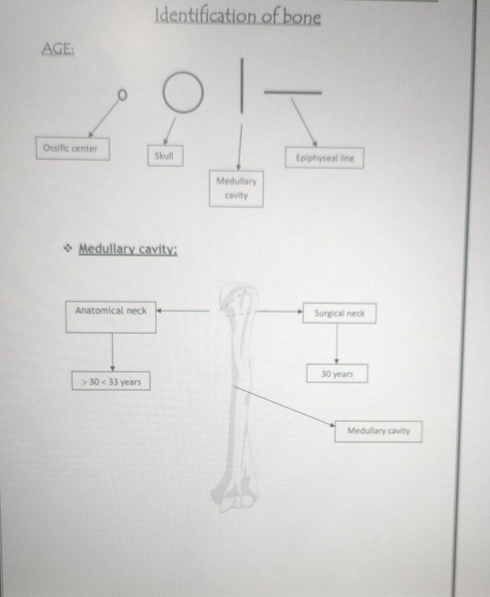
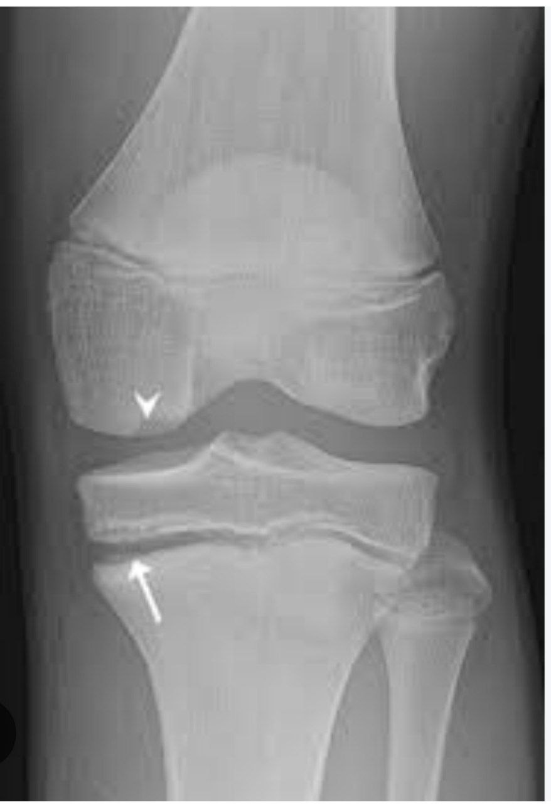

# الحلقة 1: سرّ الـ 18 سنة.. ولغز الولد "البرنس"

> **نبذة عن الحلقة:** طريقة د. شيرين الأسطورية لتقدير السن (الأشكال الهندسية الـ 4)، مراكز التعظم الجنينية ("قطرة")، التحام المشاش، وقاعدة الإناث الشرعية لحل قضية "البرنس".

---

### 🎙️ الشخصيات:
- **د. طارق:** الطبيب الشرعي العاقل والراسي، شارب منهج الطب الشرعي، وبيربط الأرقام بمواقف وقفشات أبطال الذاكرة.
- **عاطف:** طالب الطب المطحون، بيمثل صوت الطالب في سكشن المشرحة وامتحانات الأوسبي والفاينال بهبداته الذكية.

---

**د. طارق:** أهلاً بيكم يا دكاترة المستقبل في أولى حلقات بودكاستنا الطبي الشرعي "كود العظام". النهاردة مش جايين نسمّع دش كتب ولا نحفظ جداول صماء تقفل النفس وتسقّط في الفاينال؛ إحنا جايين نشغّل مخنا بأذكى التحشيشات الطبية الشرعية اللي اتعلمناها من كبار أساتذتنا، ونفهم إزاي عظمة واحدة في جسمك ممكن تودّي متهم حبل المشنقة أو تطلعه براءة! ومعايا في الاستوديو زميلنا وحبيبنا عاطف.. طالب تالتة طب المطحون.

**عاطف:** أهلاً دكتور طارق.. أنا جاي النهاردة وناذر نذر في المشرحة: لو ما فهمتش يعني إيه "إيدنتيفيكيشن" وحسيت إن دماغي ساحت في أرقام العظام زي كل سنة، أنا هحوّل تجارة إنجليزي الصبح! دا أنا في سكشن العملي اللي فات الدكتور سألني عن سن عظمة الفخذ قولتله شكلها مولودة في التمانينات طردني برا!

**د. طارق:** ههههههه! لا اطمن يا عاطف، مش هتحوّل ولا حاجة وهتدخل الفاينال تقفله. بس قبل أي كلام نظري، خد الـ Case الجنائية السخنة دي واصحى معايا..

## 📌 الخطاف واللغز: Case رقم 1 (لغز البرنس ومحكمة الأحداث)

**د. طارق:** الساعة 2 بالليل، كمين شرطة قبض على شاب مسجل بيسمي نفسه "البرنس" متلبس في جريمة قتل وسرقة بالإكراه. محاميه دخل النيابة مفرود الضهر وفرحان ومعاه شهادة ميلاد مطلعة ومكتوب فيها إن الواد عنده "15 سنة و9 شهور"! المحامي بيطالب بإحالة القضية فوراً لمحكمة الأحداث، ومستحيل يتحاكم كبالغ أو ياخد إعدام أو مؤبد. النيابة شاكة إن شهادة الميلاد مضروبة، خصوصاً إن المتهم شحط وبدقن ومعدي الـ 80 كيلو.. وكيل النيابة انتدب الطب الشرعي وسأل سؤال واحد: "هل المتهم ده حدث تحت الـ 18 سنة، ولا بالغ كامل المسؤولية الجنائية؟" القاضي قال: "الأشعة تحكم!".. وبعتوه لقسم الأشعة في مصلحة الطب الشرعي وعملوا له صور إكس-راي (X-ray) على كوعه، ورسغ إيده، وركبته. تفتكر يا عاطف، الدكتور الشرعي قرأ الأشعة إزاي وعرف سنه الحقيقي بالمللي؟

**عاطف:** بسيطة جداً يا دكتور! نبص في عينه.. لو بيغمز وواثق من نفسه يبقى شحط كبير، لو اتكسف وبص في الأرض يبقى عيل حدث غلبان!

**د. طارق:** أهي دي الهبدة اللي توديك في داهية وتخسرنا القضية في المحكمة! ركز بقى يا عاطف عشان دي أول محطة بتنزل في امتحانات الشفوي والنظري.

## 📌 المحطة الأولى: استعراف (Identification) مش مجرد تعرّف!

**د. طارق:** في الطب الشرعي عندنا مصطلح اسمه Identification، وأساتذتنا بيحبوا يترجموه بكلمة "استعراف" مش مجرد "تعرّف". عارف ليه يا دكتور عاطف؟

**عاطف:** عشان بنستعرف عليه.. يعني بنعمل نفسنا مش عارفينه الأول وبعدين نعمل معاه الواجب؟

**د. طارق:** لا يا فالح! في اللغة العربية زيادة الألف والسين والتاء تفيد "الطلب وبذل الجهد"، زي "استطعم" يعني طلب الطعام وبذل مجهود عشان يدوقه؛ فالطبيب الشرعي هنا بيبذل أقصى ما عنده من علم وأشعة وتحاليل عشان يثبت بما لا يدع مجالاً للشك إن الشخص ده هو فلان بعينه. والاستعراف ده بيطلب مننا في المشرحة لتلات حالات: ١. شخص حي (Living): زي المتهم بتاعنا "البرنس" عشان نحدد سنه وأهليته. ٢. جثة لسه ميتة أو متقطعة (Dead body or parts): في حوادث القطارات والانفجارات. ٣. شوية عظام مجهولة (Skeletal remains): مدفونة في الصحراء أو قاع النهر.

**عاطف:** طب سؤال منطقي يا دكتور طارق.. هو إحنا ليه بنرجع للعظم والأشعة بالذات؟ ما نبص على بطاقته أو شهادة ميلاده ونخلص؟

**د. طارق:** لأن الورق بيتزوّر والشهود بتكذب والجلد بيتحلل ويعفن.. لكن العظم هو الأرشيف الإلهي الحي داخل جسم الإنسان! العظام بتنمو بنظام بيولوجي دقيق من أول ما كنت جنين في بطن أمك لحد ما توصل لسن الشيخوخة، وكل مرحلة عمرية بتسيب بصمتها على العظم ومستحيل تتزور!

## 📌 المحطة الثانية: طريقة د. شيرين الأسطورية (الأشكال الهندسية الـ 4 لتقدير السن)

**د. طارق:** عشان تحفظ تقدير السن من العظام وماتنساهوش طول حياتك، لازم ننسب الفضل لأهله؛ دي الطريقة العبقرية اللي اتعلمناها من أستاذتنا دكتورة شيرين. دكتورة شيرين لخصت تقدير السن في الهيكل العظمي كله في 4 أشكال هندسية بسيطة جداً: • دايرة صغيرة. • دايرة كبيرة. • خط بالطول. • خط بالعرض. ارسمهم في خيالك دلوقتي يا عاطف!

**عاطف:** دايرة صغيرة، ودايرة كبيرة، وخط بالطول، وخط بالعرض.. دي خريطة كنز دي يا دكتور ولا رسم هندسي؟ فسرلي يا غالي!

*طريقة د. شيرين الأصلية: الأشكال الهندسية الـ 4 لتقدير السن (دايرة صغيرة، دايرة كبيرة، خط بالطول، خط بالعرض)*

**د. طارق:** دي خريطة قفل امتحان الطب الشرعي! ركز معايا: ١. الدايرة الصغيرة: دي مراكز التعظم (Ossification Centers) اللي بتظهر في الغضاريف. ٢. الدايرة الكبيرة: دي الجمجمة (The Skull) ومعاها الأسنان والدرزات واليافوخ. ٣. الخط بالطول: ده القناة النخاعية (Medullary Cavity) اللي بتشق العظمة بالطول. ٤. الخط بالعرض: ده خط المشاشة أو التحام المشاش (Epiphyseal Union).

**عاطف:** الله عليك! طب ابدألي بالسهل عشان افتح نفسي.. إيه حكاية الخط بالطول ده؟

**د. طارق:** الخط بالطول يا سيدي هو الـ Medullary Cavity؛ ده عبارة عن نمو نخاع العظم (Bone marrow) جوه تجويف العظمة الطويلة زي عظمة العضد (Humerus). النخاع بيبدأ يشق طريقه وينمو بطول العظمة طالع لفوق: • عند سن 30 سنة: يوصل لحد العنق الجراحي (Surgical neck). • عند سن 33 سنة: يكمل ويوصل للعنق التشريحي (Anatomical neck) تحت الرأس مباشرة! كلمتين سهلين: 30 جراحي.. و 33 تشريحي! وبكده خلصنا الخط بالطول في ثانية!

## 📌 المحطة الثالثة: الدايرة الصغيرة.. مراكز التعظم ("قطرة" و"واحد فوق واتنين تحت")

**د. طارق:** تعال بقى للدايرة الصغيرة: مراكز التعظم (Ossification Centers). ونبدأ بالفترة الجنينية داخل الرحم (Intrauterine)؛ الجنين في بطن أمه بتظهر له مراكز تعظم في شهور فردية وزوجية مرتبة: 5، 7، 8، 9 شهور! ولخصوها في كلمة "قطرة" (Ca - T - Ra) وتحشيشة الحروف: • عند 5 شهور: عظمة الكعب (Calcaneus)؛ حرف الـ C لو قفلته بإيدك يبقى شبه رقم 5 بالعربي! • عند 7 شهور: عظمة الكاحل (Talus)؛ حرف الـ T شبه رقم 7 بالإنجليزي، ودي العظمة اللي تحت القصبة. • عند 8 شهور: أسفل عظمة الفخذ (Lower end of Femur)؛ حرف الـ F مقلوبة شبه رقم 8 بالإنجليزي! • عند 9 شهور (سن الولادة Full Term): احفظ قاعدة "Nine = Knee"! الركبة عند 9 شهور.. وعشان الـ 9 هو أكبر رقم في الحمل، طمع وأخد معاه عظمة زيادة اسمها الـ Cuboid (عظمة مكعبة)! يعني عند الولادة بيظهر مركز أسفل الفخذ، وأعلى القصبة، وعظمة الـ Cuboid!

**عاطف:** يا جماله! 5 كعب (Calcaneus)، 7 تالوس (Talus)، 8 فخذ (Lower Femur)، و 9 ركبة Knee مع العظمة الطماعة المكعبة Cuboid! طب بعد ما الواد يتولد وينزل الدنيا، مراكز أطرافه بتمشي إزاي؟

**د. طارق:** قاعدة أستاذتنا د. شيرين الذهبية للأطراف بعد الولادة: "واحد فوق.. واتنين تحت!": • سنة واحدة (1 Year - واحد فوق): يظهر مركز التعظم في أعلى عظمة العضد (Upper end of Humerus) وأعلى الفخذ (Upper Femur). • سنتين (2 Years - اتنين تحت): يظهر مركز التعظم في أسفل عظام الساق؛ القصبة والشظية (Lower end of Tibia & Fibula)، ومعاهم كمان أسفل الكعبرة (Lower end of Radius) اللي بتبدأ عند سنتين وتملى تلتين العظمة عند 7 سنين! شوفت البساطة؟ واحد فوق.. واتنين تحت!

**عاطف:** واحد فوق عند سنة، واتنين تحت عند سنتين! طب ومنطقة الكوع الملعونة اللي كانت معقداني في الأناتومي يا دكتور؟

**د. طارق:** الكوع لعبته "المقص" (The Scissors Rule)! بتعمل مقص بين رقم 6 ودبل الرقم اللي هو 12: • عند سن 6 سنين: يظهر مركز التعظم في أعلى الكعبرة (Upper end of Radius). وتعمل معاها مقص مع 12؛ وقاعدتنا بتقول: "نفس الذراع بيشيل نفس الرقم.. ومقص كامل من فوق، ونص مقص من تحت"! يعني أسفل الزند (Lower end of Ulna) تاخد الـ 6 سنين هي كمان في نص المقص التحتاني! وبكده قفلنا مراكز التعظم للأبد.

## 📌 المحطة الرابعة: الخط بالعرض.. التحام المشاش وساعة سن التخرج ("قمر 14" و سن 21 و 23)

**د. طارق:** نيجي للخط بالعرض: التحام المشاش (Epiphyseal Union)؛ وده الخط الفاصل بين المشاشة (Epiphysis) وجسم العظمة (Diaphysis) لما يقفل وينتهي نمو الطول. ركز بقى في التحشيشات العبقرية لمفاصل الجسم: ١. منطقة الكوع بتلتحم بدري: • قمر 14 (14 شهر): عظمة الـ Capitulum الدائرية شبه القمر بتلتحم مع الـ Trochlea! • سن الجمباز (15 سنة): الـ Trochlea والـ Capitulum يلتحموا مع جسم عظمة العضد (Shaft). • مقص الـ 16 والـ 17: الـ Lateral epicondyle عند 16 سنة، والـ Medial epicondyle عند 17-18 سنة ومعاها الـ Lesser trochanter في الفخذ (قاعدة 2 L).

**عاطف:** قمر 14 في الشهور، وسن الجمباز 15 سنة، ومقص 16 و 17 في الكوع! طب واليد ورأس الفخذ وسن الرشد؟

**د. طارق:** ٢. كفك وسن الـ 18 سنة (قمة الهرم القضائي): • بص لكف إيدك يا عاطف.. كفك مكتوب فيه 18 و 81 من أسماء الله الحسنى! عند سن 18 سنة بتلتحم عظام مشط اليد والسلاميات (Metacarpals & Phalanges)، ومعاها أعلى الفخذ (Head of Femur) وأسفل القصبة والشظية (Lower Tibia & Fibula)! • وسن 18 سنة ده هو الخط الفاصل جنائياً: اكتمال المسؤولية الجنائية الكاملة، والتحاكم أمام محكمة الجنايات العادية، والتجنيد، ورخصة القيادة، وسن الاعتداد برضا الأنثى في قضايا الشرف! ٣. الساعة والشنطة عند سن 20 سنة: • الساعة بتلبسها في رسغك (Lower end of Radius & Ulna)، والشنطة بتشيلها على كتفك في العضد (Upper end of Humerus).. الساعة والشنطة يقفلوا عند 20 سنة!

**عاطف:** الله أكبر! كفي 18 سنة، والساعة والشنطة 20 سنة! طب والركبة يا دكتور طارق؟

**د. طارق:** ٤. سن تخرج الكليات التانية (21 سنة): • طلبة الكليات التانية بيتخرجوا عند سن 21 سنة؛ بيعملوا حاجتين: بيلعبوا كورة في النادي، وبيقعدوا في البيت! فبيلعبوا كورة في النادي تبقى الركبة (The Knee: Lower Femur + Upper Tibia) تقفل عند 21 سنة! وبيقعدوا في البيت محتاجين عظمة الحوض اللي بنقعد عليها الـ (Ischial Tuberosity) تلحم وتبقى قوية عند 21 سنة! وده سن كمال الأهلية المدنية (Full Civil Rights) وانتهاء الوصاية واستلام الميراث! ٥. سن تخرج طالب الطب الغلبان (23 سنة): • دكتور الطب بيتخرج عند سن 23 سنة.. ولازم يشيل مسؤولية على كتافه؛ فيلتحم الطرف الداخلي لعظمة الترقوة (Medial end of Clavicle)، ومعاها حافة الحوض (Iliac Crest)، وقاعدة الجمجمة (Basilar Suture)! وعظمة الترقوة دي بتمتد لحد 25-28 سنة عشان تكون آخر عظمة تلتحم في جسم الإنسان كله!

## 📌 المحطة الخامسة: القاعدة الذهبية الشرعية (قاعدة الإناث: الهيفات والدواير)

**عاطف:** طب سؤال خبيث يا دكتور.. الأرقام العظيمة دي كلها خاصة بالذكور، طب لو الجثة أو المتهم بنت أنثى، بنعمل إيه في الامتحان وفي تقرير الطب الشرعي؟

**د. طارق:** دي بقى أخطر تريكة بتسقّط الدفعات في الفاينال! احفظ القاعدة الشرعية دي زي اسمك: "الفيميل تسبق الميل بسنتين في الهيفات.. لكن متسبقوش في الدواير!"

**عاطف:** يعني إيه تسبق في الهيفات ومتسبقش في الدواير؟ إيه الألغاز دي يا دكتور؟

**د. طارق:** الهيفات يعني الأطوال: الخط بالطول والخط بالعرض! يعني مراكز تعظم الأطراف والتحام المشاش (Epiphyseal Union)، البنت بتسبق الولد بسنتين عشان تبلغ وتنمو بدري؛ يعني لو الركبة عند الولد بتقفل عند 21 سنة، عند البنت تقفل عند 19 سنة (Female = Male - 2 years في سن الالتحام، أو بتسبقه بسنتين)! لكن متسبقوش في الدواير: يعني الدايرة الكبيرة اللي هي الجمجمة (سوتشرز ويافوخ وأسنان)، والدايرة الصغيرة، والقناة النخاعية.. البنت زي الولد بالظبط (Female = Male) ومفيش أي فرق!

**عاطف:** يخربيت الحلاوة! البنات يسبقونا بسنتين في الأطوال والمشاشات عشان يلحقوا يطولوا، لكن في الدواير والجمجمة والأسنان العقل والجمجمة زي بعض بالمللي!

## 📌 المحطة السادسة: كشف سر "البرنس" أمام النيابة

**د. طارق:** دلوقتي بقى يا دكتور عاطف، ارجع لقضية المتهم "البرنس"؛ محاميه داخل يتبغدد بشهادة ميلاد 15 سنة و9 شهور وعايز يحيله لمحكمة الأحداث ويفلت من حبل المشنقة. تقرير الأشعة بتاعنا من مصلحة الطب الشرعي طلع الآتي: ١. أشعة الكوع: الـ Lateral epicondyle ملتحمة تماماً (Complete Union). ٢. أشعة اليد والرسغ: عظام مشط اليد (Metacarpals) وأسفل الكعبرة ملتحمين بالكامل (Complete Union). ٣. أشعة الركبة: الخط الغضروفي بين أسفل الفخذ وأعلى القصبة مفتوح تماماً ومش لاحم (Non-union). احكم يا قاضي المشرحة!

*أشعة ركبة البرنس: خط المشاشة مفتوح (تحت 21 سنة) بينما كوعه ورسغه لاحمين بالكامل (فوق 18 سنة)*

**عاطف:** بسسس! امسك الحرامي المزور واديله حبل المشنقة! • أولاً: كوعه لاحم عند الـ Lateral epicondyle، يبقى معدي سن الجمباز والـ 16 سنة مستريح! • ثانياً: والأخطر والفيصل الجنائي.. كف إيده (Metacarpals) ورسغه ملتحمين بالكامل، يعني قفل سن الـ 18 سنة بالمللي وطبّق كفه! وطالما معدي 18 سنة، يبقى تسقط شهادة الميلاد المزورة ويسقط ادعاء إنه حدث، ويتحاكم أمام محكمة الجنايات العادية بكامل أهليته الجنائية! • ثالثاً: وبما إن ركبته لسه مفتوحة (تحت سن 21 سنة)، هو لسه ما وصلش سن كمال الأهلية المدنية وإدارة الشركات، بس جنائياً هو شحط كامل المسؤولية ولابس في قضية قتل عمد!

**د. طارق:** الله يفتح عليك يا دكتور عاطف! قفلت القضية بالضبة والمفتاح، وأثبتت إن طريقة دكتورة شيرين (دايرة صغيرة، دايرة كبيرة، خط بالطول، خط بالعرض) مع قاعدة الهيفات والدواير حلت أصعب لغز جنائي في ثواني! نتقابل الحلقة الجاية مع لغز الجمجمة المتفحمة وسر الخياطة السحرية!
