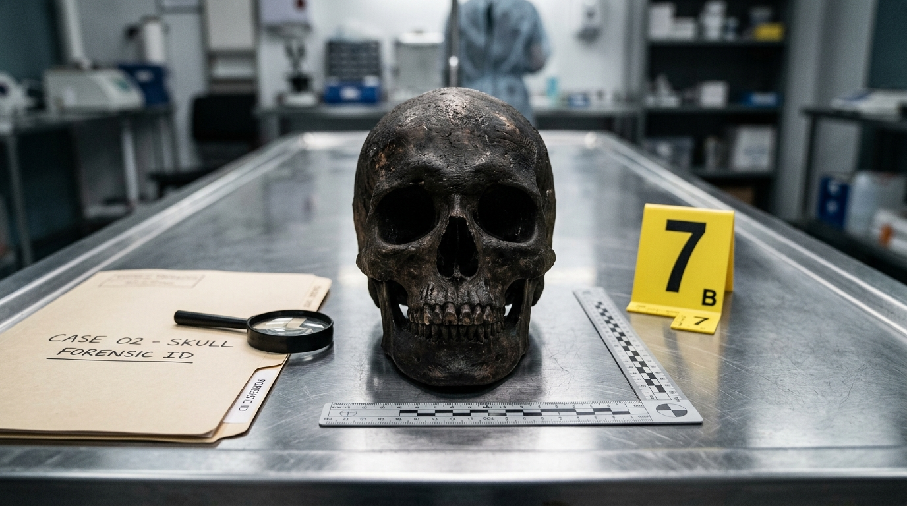

# الحلقة 2: لغز "جمجمة المشرحة المتفحمة".. وسر الخياطة السحرية!

> **نبذة عن الحلقة:** تحديد الجنس والسن من الجمجمة؛ الفروق الـ 5 لتحديد الجنس، محيط رأس الوليد (13 بوصة)، اليافوخ وقاعدة الـ 3 صوابع، وساعة درزات الجمجمة (Metopic، Basilar، وقاعدة S-C-L 30-40-50).

---

### 🎙️ الشخصيات:
- **د. طارق:** الطبيب الشرعي العاقل والراسي، شارب منهج الطب الشرعي، وبيربط الأرقام بمواقف وقفشات أبطال الذاكرة.
- **عاطف:** طالب الطب المطحون، بيمثل صوت الطالب في سكشن المشرحة وامتحانات الأوسبي والفاينال بهبداته الذكية.

---

**د. طارق:** أهلاً بيكم يا دكاترة في الحلقة التانية من بودكاست "كود العظام". بعد ما فككنا شفرة أطراف المتهم "البرنس" وكشفنا تزويره؛ النهاردة هنطلع لأعلى قمة في الهيكل العظمي.. الجمجمة (The Skull)، الصندوق الأسود اللي بيحتفظ بأسرار صاحبه حتى لو اتحول لفحم ورماد! إزيك يا عاطف يا بطل؟

**عاطف:** أهلاً دكتور طارق.. أنا من بعد حلقة الكوع والـ 18 سنة وأنا ماشي في كليتنا القصر العيني ببص على مفاصل الدكاترة وأقول ده معدي وده لسه! بس قولي يا دكتور، إيه حكاية الجمجمة المتفحمة دي؟ أنا محضر كشكول الأوسبي ومتحمس!

## 📌 الخطاف واللغز: Case رقم 2 (حريق المخزن المهجور)

**د. طارق:** حريق هائل ولّع في مخزن بضائع مهجور على أطراف القاهرة؛ بعد ما المطافي سيطرت على النيران، عمال الإنقاذ لقوا تحت الردم هيكل عظمي متفحم تماماً وضايع منه كل الأنسجة الرخوة، ومفيش أي أثر للجلد أو بصمات الأصابع أو ملامح الوش. المباحث لقت في سجلات المتغيبين في محيط المنطقة شخصين اختفوا في نفس الليلة: ١. أستاذ فوزي: رجل أعمال عنده 45 سنة. ٢. الآنسة رانيا: محاسبة في المخزن عندها 28 سنة. النيابة بعتت للطب الشرعي عظام الجمجمة ومعاها الفك السفلي وسألت: "الجثة دي لراجل ولا ست؟ وهل دي جثة أستاذ فوزي ولا الآنسة رانيا؟"

*فحص جمجمة المشرحة المتفحمة في حريق المخزن لتحديد الجنس والعمر بالدرزات*

**عاطف:** سهلة جداً يا دكتور! نشم ريحة الجمجمة، لو ريحتها برفان حريمي تبقى رانيا، لو سجاير كليوباترا يبقى عم فوزي ونقفل المحضر!

**د. طارق:** ريحة إيه يا عاطف وبنقولك متفحمة وريحتها شياط وحريق؟! ركز معايا عشان السؤال ده بيجي في كل امتحانات الشفوي: إزاي تفرق بين جمجمة ذكر وأنثى بالعين المجردة؟

## 📌 المحطة الأولى: راجل ولا ست؟ (الـ 5 فروق الجوهرية في الجمجمة)

**د. طارق:** قاعدة ذهبية قبل ما نبدأ: قبل سن 14 سنة (سن البلوغ)، مستحيل كطبيب شرعي تفرق بين عظام الولد والبنت؛ لأن هرمون التستوستيرون هو اللي بيبدأ يفرز بعد البلوغ ويخلي عظام الذكر تتقل والبروزات العضلية تبرز وتخشن. تعال نثبت الـ 5 فروق الذهبية في الجمجمة البالغة: ١. الحجم والوزن (Size & Weight): جمجمة الراجل ضخمة وثقيلة (Bigger & Heavier)، بينما جمجمة الست صغيرة وخفيفة وناعمة (Smaller, Lighter & Smoother). ٢. بروز الحواجب (Supra-orbital ridges): الراجل عمال يكشر ويغمز، فعنده بروز عظمي فوق العين بارز ومحسوس جداً (Prominent)، أما الست فعندها الحتة دي ملساء وناعمة (Smooth / Less marked). ٣. زاوية الجبهة مع الأنف (Fronto-nasal junction): عند الراجل زاوية حادة خشنة محفورة (Angular)، وعند الست كيرف ناعم وانسيابي (Smooth curve). ٤. بروز خلف الأذن (Mastoid & Styloid process): في الراجل بروزات ضخمة وطويلة (Long & bulky) عشان عضلات الرقبة القوية، وفي الست رقيقة وقصيرة (Short & small). ٥. لقمة مؤخرة الجمجمة (Occipital condyles): القاعدة اللي الجمجمة بتسند بيها على فقرات الرقبة؛ في الراجل طويلة وضيقة (Long & narrow)، وفي الست عريضة وقصيرة (Short & broad).

**عاطف:** يا سلام! يعني نلخصها في كلمة: الراجل كتلته بارزة، خشنة، محفرة، وزواياه حادة.. والست كل تضاريس جمجمتها ملساء، رقيقة، وناعمة!

## 📌 المحطة الثانية: محيط الرأس واليافوخ (Dimensions & Fontanelles)

**د. طارق:** تعال بقى نرجع للدايرة الكبيرة في طريقة دكتورة شيرين: الجمجمة لتقدير العمر! نبدأ من أول الولادة: • محيط رأس الجنين (Circumference at birth): بينزل الطفل برقم النحس في الثقافات القديمة وهو "13 بوصة" (13 Inches)! • واليافوخ (Fontanelles)؛ الجمجمة فيها شبابيك غضروفية لسه ما قفلتش: ١. اليافوخ الخلفي (Posterior Fontanelle): بيقفل عند الولادة (At birth) لو الطفل مكتمل النمو (Full term) أو خلال شهرين لتلاتة بعد الولادة. ٢. اليافوخ الأمامي (Anterior Fontanelle): بيقفل عند سن "18 شهر" (سنة ونص)! وقاعدته الأسطورية "قاعدة الـ 3 صوابع": أول ما يتولد تحط 3 صوابع يدخلوا في اليافوخ، وكل 6 شهور ينقص صباع؛ عند 6 شهور يدخل صباعين، عند 12 شهر يدخل صباع واحد، وعند 18 شهر يقفل تماماً وما يدخلش ولا صباع!

**عاطف:** الله! 13 بوصة عند الولادة، واليافوخ الخلفي عند الولادة أو شهرين، والأمامي بقاعدة التلات صوابع يقفل عند 18 شهر (سنة ونص)! طب والدرزات وخياطات الجمجمة يا دكتور؟

## 📌 المحطة الثالثة: درزات الجمجمة (ساعة السوتشر: Metopic، Basilar، و S-C-L 30-40-50)

**د. طارق:** درزات الجمجمة (Cranial Sutures) دي بقى ساعة بيولوجية دقيقة جداً: ١. الدرز الجبهي (Metopic Suture): المثل الشعبي بيقول "اللي مكتوب على الجبين لازم تشوفه العين"؛ ومكتوب على الجبين 3 حاجات: الحياة والموت والرزق! فيقفل عند "3 سنين" (وفي مراجع تانية سنتين). ٢. درز قاعدة الجمجمة (Basilar Suture): بين الـ Basi-occiput والـ Basi-sphenoid؛ وده درز سن تخرج طالب الطب الغلبان عند "23 سنة" (أو 18-21 في مصادر تانية). ٣. درزات القبة الثلاثية: قاعدة (S - C - L) والأرقام (30 - 40 - 50)! احفظ الترتيب ده: • حرف الـ S: السهمي (Sagittal Suture)؛ سن الترشح لمجلس الشعب عند "30 سنة" (يقفل من 30 لـ 35 سنة من الداخل للخارج Endocranial to Ectocranial). • حرف الـ C: الإكليلي أو التاج (Coronal Suture)؛ القرآن والوحي نزل تاج على النبي ﷺ عند "40 سنة" (يقفل من 35 لـ 40 سنة). • حرف الـ L: اللامي (Lambdoid Suture)؛ افتكرها بـ "روح نام.. داخل على المعاش" عند "50 سنة" (يقفل من 45 لـ 50 سنة)! • وأخيراً: المحو الكامل (Complete Obliteration) واختفاء كل معالم الدرزات تماماً عند سن "60 سنة"!

**عاطف:** S - C - L.. 30، 40، 50، ومحو كامل عند 60! 30 مجلس شعب سهمي، 40 تاج كورونال، 50 روح نام لامدويد، و 60 مع السلامة يا سوتشرز! طب والفك السفلي أخباره إيه؟

## 📌 المحطة الرابعة: الفك السفلي وقاعدة الإناث في الدواير

**د. طارق:** الفك السفلي (The Mandible) له زاوية (Mandibular angle) بتتحول على مدار العمر: • في الأطفال: الزاوية منفرجة واسعة جداً (140 درجة) عشان مفيش أسنان. • في الشباب البالغين: الزاوية بتتحول لقائمة وقوية (110 - 120 درجة) مع بزوغ الأسنان والمضغ القوي. • في كبار السن (العواجيز): بعد تساقط الأسنان وضمور اللثة ترجع الزاوية تنفرج تاني لـ 140 درجة ويدخل الفك لجوه ويبرز الدقن! وقبل ما نحل القضية، فكرني بقاعدة الإناث في الجمجمة يا عاطف؟

**عاطف:** فاكرها وصاممها! "الفيميل تسبق الميل في الهيفات (الأطوال)، لكن متسبقوش في الدواير"! والجمجمة دايرة كبيرة، يعني درزات الجمجمة واليافوخ عند الست زي الراجل بالظبط (Female = Male) ومفيش فرق سنتين!

## 📌 المحطة الخامسة: حل لغز "الجثة المتفحمة"

**د. طارق:** تسلم دماغك! ارجع بقى لقضية المخزن المحترق: فحصنا جمجمة الجثة المتفحمة، والتقرير الشرعي أثبت الآتي: ١. الـ Supra-orbital ridges بارزة وخشنة جداً، والـ Mastoid process ضخمة وطويلة، ولقمة مؤخرة الرأس طويلة وضيقة. ٢. الدرز السهمي (Sagittal Suture) ملتحم وممسوح تماماً من الداخل والخارج. ٣. الدرز الإكليلي (Coronal Suture) ملتحم في الجزء الداخلي وفي نصه الخارجي. ٤. الدرز اللامي (Lambdoid Suture) لسه مفتوح وباين ومش لاحم. ٥. زاوية الفك السفلي قائمة وقوية حوالي 115 درجة. قولي بقى.. الجثة دي جثة مين في الاتنين؟

**عاطف:** الحكم بعد المداولة والتشريح: • أولاً تحديد الجنس: الحواجب بارزة والمستويد ضخم والجمجمة خشنة وتضاريسها بارزة، يبقى الجثة دي جثة "ذكر" مية في المية! وبكده تسقط الآنسة رانيا من الحسابات فوراً! • ثانياً تحديد السن: الساجيتال لاحم (معدي 30-35)، والكورونال لاحم أغلبه (معدي 40 سنة)، بس اللامدويد لسه مفتوح (يعني لسه ما وصلش 50 سنة)! يبقى عمر صاحب الجمجمة دي محصور بين 40 و 45 سنة بالمللي! • ثالثاً النتيجة النهائية: دي جثة أستاذ فوزي (45 سنة) بالتمام والكمال! وبكده نبلغ النيابة ونسلّم الرفات لأهله!

**د. طارق:** عبقري يا عاطف! قفلت لغز الجمجمة المتفحمة في دقائق، وأثبتت إن عظام الجمجمة صندوق أسود لا يخيب أبداً. نلتقي في الحلقة التالتة مع لغز حوض الغريقة المجهولة!
