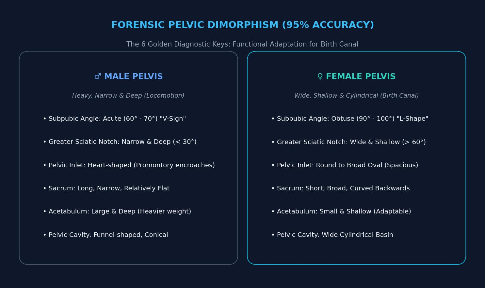

# الحلقة 3: لغز "حوض الغريقة المجهولة".. وشفرة عظام الولادة

> **نبذة عن الحلقة:** الحوض الملك المتوج لتحديد الجنس (دقة 95%)، الـ 6 فروق الذهبية، وساعة الحوض العمرية بالتحشيشات المصرية (أولى ابتدائي 6y، سن الجمباز 15y، سن التخرج 21y و 23y).

---

### 🎙️ الشخصيات:
- **د. طارق:** الطبيب الشرعي العاقل والراسي، شارب منهج الطب الشرعي، وبيربط الأرقام بمواقف وقفشات أبطال الذاكرة.
- **عاطف:** طالب الطب المطحون، بيمثل صوت الطالب في سكشن المشرحة وامتحانات الأوسبي والفاينال بهبداته الذكية.

---

**د. طارق:** أهلاً بيكم يا دكاترة في الحلقة التالتة من بودكاست "كود العظام". لو كانت الجمجمة هي الصندوق الأسود لتحديد السن بنسبة 70-80%؛ فالعظمة اللي معانا النهاردة هي الملك المتوج لتحديد الجنس بنسبة دقة بتوصل لـ 95% بمفردها! النهاردة ميعادنا مع الحوض (The Pelvis).. وشفرة عظام الولادة. إزيك يا عاطف؟

**عاطف:** أهلاً دكتور طارق.. أنا سمعت إن الحوض ده في امتحان العملي هو طوق النجاة، أول ما تلمسه تعرف الضحية راجل ولا ست في ثانية! قولي بقى، إيه اللغز اللي معانا في المشرحة النهاردة؟

## 📌 الخطاف واللغز: Case رقم 3 (شوال النيل الغارق)

**د. طارق:** شرطة المسطحات المائية في الجيزة انتشلت شوال خيش مربوط بحبل ومثقل بحجارة من قاع النيل؛ لما فتحوه في المشرحة لقوا هيكل عظمي متحلل بالكامل وبقاله في المية العذبة أكتر من سنة ونصف، وكل ملامح الوجه والأنسجة ضايعة، وعظام الجمجمة مكسرة ومتهشمة تماماً بفعل اصطدامها بصخور النيل وتيارات المياه! مفيش غير عظام الحوض سليمة بنسبة 100%. النيابة بتسألنا عن جثتين اختفوا في نفس التوقيت: ١. الحاج رضوان: تاجر مواشي عنده 55 سنة. ٢. الآنسة سهام: ممرضة شابة عندها 29 سنة. تفتكر يا عاطف، الحوض هيحل اللغز ده إزاي؟

**عاطف:** بما إن الجمجمة متهشمة، يبقى الحوض هو بطل الفيلم! بس يا دكتور، إيه الحكمة اللي تخلي الحوض بالذات أدق عظمة لتحديد الجنس بنسبة 95%؟

## 📌 المحطة الأولى: فلسفة الحوض.. "طريق خروج البيبي"

**د. طارق:** الفلسفة البيولوجية كلها بتتلخص في جملة واحدة يا عاطف: "الحوض في الأنثى مخلوق عشان يكون طريقاً لمرور رأس الجنين أثناء الولادة (Birth Canal)"! حوض الراجل مخلوق لحمل وزن الجسم والحركة بس، فالعظام سميكة والمدخل ضيق؛ بينما حوض الست متصمم كحوض واسع ومسطح ومفتوح عشان يسمح بتمدد الرحم وولادة طفل سليم!

## 📌 المحطة الثانية: المقارنة الذهنية (Male vs Female Pelvis - الـ 6 فروق)

**د. طارق:** تعال نثبت الـ 6 فروق الذهبية في الحوض اللي بتدخل بيهم أي لجنة شفوي تقفلها: ١. الزاوية تحت العانة (Subpubic Angle): في الست منفرجة واسعة جداً (90 - 100 درجة) شبه الزاوية بين الإبهام والسبابة، في الراجل حادة وضيقة (60 - 70 درجة) شبه علامة النصر بالصوابع (V-shaped)! ٢. الثلمة الوركية الكبرى (Greater Sciatic Notch): في الست واسعة وعريضة وسطحية (Wide & Shallow)، وفي الراجل ضيقة وعميقة (Narrow & Deep). ٣. مدخل الحوض (Pelvic Inlet): في الست دائري أو بيضاوي عريض (Round / Oval)، وفي الراجل شبه قلب ورق اللعب في الكوتشينة (Heart-shaped) لأن عظمة العجز بارزة لجوه! ٤. عظمة العجز (Sacrum): في الست قصيرة وعريضة ومقعرة لورا عشان تسيب مساحة (Short, Broad & Curved)، وفي الراجل طويلة وضيقة ومستقيمة (Long & Narrow). ٥. التجويف الحقي (Acetabulum): في الراجل تجويف ضخم عشان يشيل رأس الفخذ الكبيرة والوزن الثقيل، وفي الست صغير وأقل عمقاً. ٦. مظهر الحوض العام: في الراجل مخروطي طويل وثقيل، وفي الست أسطواني قصير وعريض وخفيف!

*الفروق الجنائية الـ 6 بين حوض الذكر والأنثى (الزاوية تحت العانة، الثلمة الوركية، ومدخل الحوض)*

**عاطف:** يا جمال التقسيمة! حوض الست واسع ومنفرج ومدخله بيضاوي وزاويته قائمة وشبه حرف الـ L، وحوض الراجل ضيق وعميق وقلب كوتشينة وعلامة V! طب بالنسبة للسن من الحوض يا دكتور؟

## 📌 المحطة الثالثة: ساعة الحوض العمرية بالتحشيشات الأصلية

**د. طارق:** الحوض فيه ساعة عمرية عبقرية تابعة للخط بالعرض في طريقة أستاذتنا د. شيرين: ١. سن أولى ابتدائي والمشي للمدرسة (6 سنين): بيلتحم عظم العانة مع عظم الورك (Pubic Ramus مع Ischial Ramus)! ده السن اللي الطفل بيبدأ يروح فيه المدرسة ويمشي براحته. ٢. سن الجمباز التحتاني (15 سنة): المفصل الحقي (Acetabulum)؛ بيلتحم فيه الغضروف الثلاثي الـ Y-shaped Triradiate Cartilage اللي رابط بين الـ Ilium والـ Ischium والـ Pubis عند سن 15 سنة! فاكر يا عاطف سن الجمباز الفوقاني؟ كان الكوع عند 15 سنة برضه! سن الجمباز فوق وسن الجمباز تحت! ٣. سن تخرج الكليات التانية وقعدة البيوت (21 سنة): عظمة الـ Ischial Tuberosity اللي بنقعد عليها تلحم عند 21 سنة! ٤. سن تخرج طالب الطب ومسؤولية الكتاف (23 سنة): عرف الحرقفة (Iliac Crest) يلتحم عند 23 سنة! ٥. سطح الارتفاق العاني (Symphysis Pubis): في العشرينات سطحه مليان تموجات أفقية ناعمة، في التلاتينات تظهر حافة ملساء منتظمة، وبعد الأربعين يبدأ التآكل وتظهر نتوءات عظمية (Osteophytes)!

**عاطف:** 6 سنين أولى ابتدائي، 15 سن الجمباز، 21 سن تخرج الكليات التانية وقعدة البيوت، و 23 سن تخرج طالب الطب وعرف الحرقفة! وتاني نكرر: الهيفات بتسبق بسنتين في الإناث، يعني لو أنثى ننقص سنتين في سن الالتحام!

## 📌 المحطة الرابعة: فك شفرة "شوال النيل الغارق"

**د. طارق:** الله يفتح عليك! تعال بقى نفحص حوض الجثة اللي طلعناها من شوال النيل: ١. الزاوية تحت العانة (Subpubic Angle) منفرجة جداً وقسناها طلعت 95 درجة! ٢. الـ Greater Sciatic Notch واسعة وعريضة وسطحية. ٣. مدخل الحوض بيضاوي واسع، وعظمة العجز قصيرة وعريضة ومقعرة للخلف. ٤. فحص الالتحام العظمي: الـ Pubic & Ischial Ramus لاحمين، والـ Acetabulum ملتحم تماماً، والـ Ischial Tuberosity والـ Iliac Crest ملتحمين بالكامل! ٥. سطح الارتفاق العاني (Symphysis Pubis): الحواف ملساء منتظمة ومفيش أي تآكل أو نتوءات عظمية متقدمة. احكم يا دكتور عاطف.. الجثة دي مين؟

**عاطف:** القضية اتحلت بالضربة القاضية! • أولاً تحديد الجنس: الزاوية 95 درجة ومدخل الحوض بيضاوي واسع والـ Sciatic notch عريضة، يبقى الجثة دي جثة "أنثى" بنسبة 95% قطعية! وبكده يستحيل تكون للحاج رضوان التاجر! • ثانياً تحديد السن: كل مراكز الحوض بما فيها الـ Acetabulum (15) والـ Tuberosity (21) والـ Crest (23) ملتحمين بالكامل، يعني الضحية معدية الـ 23 سنة ومكتملة النمو؛ وسطح الارتفاق العاني فيه حواف ملساء يعني في أواخر العشرينات (حوالي 28 - 30 سنة)! • النتيجة: الجثة دي بنسبة 100% هي جثة الآنسة سهام الممرضة (29 سنة)، والحاج رضوان ملوش أي علاقة بالجثة دي!

**د. طارق:** عاش يا عاطف! رفعت راسي وطلعت التقرير الطبي الشرعي سليم ومحكم. نتقابل في الحلقة الرابعة مع لغز شنق المليونير والعظمة اللامية!
